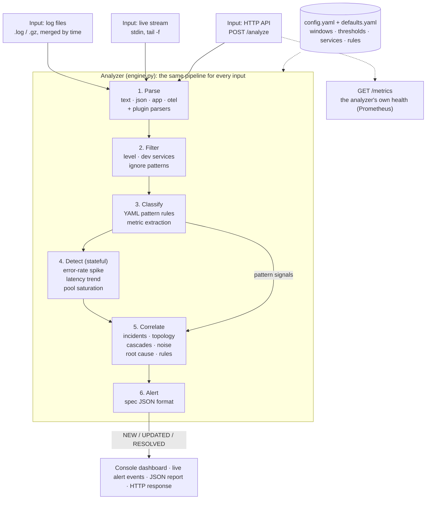

# Intelligent Log Analyzer & Alert Generator

Turns noisy, multi-service, multi-format logs into a **small number of deduplicated,
root-caused, actionable alerts**.

On the provided 10,000-line sample, **447 error lines become 5 alerts** (98.9% noise
reduction). Two are CRITICAL and each names the correct root cause with 98% confidence,
and the database pool exhaustion is flagged *before* the pool actually runs out. The
100,000-line sample is processed in about 2.7 s using 27 MB of memory.

```
[CRITICAL] Database Connection Crisis  (ALR-20251007-003)
 • Started: 14:24:31 (36m 03s ago), resolved after 17m 57s
 • Services: database -> order-service, inventory-service, payment-service, user-service, api-gateway
 • Root Cause: Database connection pool exhausted (98% confidence)
 • Action: Page the database on-call; check pool size, max_connections and long-running queries
```

| Problem statement asks for | Where it is |
|---|---|
| 1. Parse logs in various formats | Text, JSON and Monolog/app formats, plus **OpenTelemetry** (OTLP/JSON records and Collector export batches), auto-detected **per line** (the samples interleave them); plugin parsers ([`ingest/parsers.py`](src/log_analyzer/ingest/parsers.py)) |
| 2. Detect patterns and anomalies | Pattern rule library, error-rate spikes against a sliding baseline, gradual latency degradation (trend test), connection-pool saturation with time-to-exhaustion ([`detectors/`](src/log_analyzer/detectors)) |
| 3. Correlate related errors, find root causes | Evidence-based incident correlation validated against the service topology, cascade detection, root-cause scoring ([`correlation/`](src/log_analyzer/correlation)) |
| 4. Smart alerts, 90% less noise | One alert per incident in the spec's JSON format, alert lifecycle (new / escalated / resolved), background-noise inhibition |
| 5. Context to fix issues faster | Probable cause and confidence, evidence lines, suggested actions, sample logs, affected services ordered from cause to symptoms |

Contents:
- [Quick start](#quick-start)
- [Results on the provided samples](#results-on-the-provided-samples)
- [Usage](#usage)
- [Configuration](#configuration)
- [Design](#design)
- [Performance](#performance)
- [Testing](#testing)
- [Build targets](#build-targets)
- [Dependencies](#dependencies)
- [Project layout](#project-layout)
- [Assumptions and limitations](#assumptions-and-limitations)

Deeper documents:
- [docs/DESIGN.md](docs/DESIGN.md): design, how it was arrived at, trade-offs and scaling.
- [docs/ANALYSIS.md](docs/ANALYSIS.md): every alert raised on the sample logs, and why.

---

## Quick start

```bash
make install        # creates .venv and installs the package with dev tools
make run            # analyze data/sample/test_logs.txt -> console dashboard
make check          # lint + strict type check + 275 tests (coverage >= 85% enforced)
make demo           # scripted walkthrough: the 4 spec scenarios, streaming, JSON, API
```

With Docker only, no local Python needed:

```bash
docker build -t log-analyzer .
docker run --rm -t log-analyzer                                  # bundled 10k sample
docker run --rm -v "$PWD/logs:/logs:ro" log-analyzer --file /logs/app.log
tail -f app.log | docker run --rm -i log-analyzer                # live stream
docker run --rm -p 8080:8080 log-analyzer serve                  # HTTP API
docker build --target test .                                     # full test suite in a clean container
```

## Results on the provided samples

| Alert | Severity | Root cause (confidence) | What happened |
|---|---|---|---|
| Database Connection Crisis | CRITICAL | `database` (0.98) | Pool climbed 50% → 100%. The alert opened at 80% with "exhaustion in ~1 min" (it ran out 41 s later). Four services then failed to get connections and the gateway timed out on them. |
| Payment Provider Health Checks Failing - Cascading Failure Across 5 Services | CRITICAL | `payment-provider` (0.98) | A third-party provider refused connections. The failure rippled from payment-service to order-service, api-gateway and web-app. |
| Performance Degradation: Rising Database Query Time Affecting 3 Dependent Services | MEDIUM | `database` (0.91) | Query time rose 2.4x and request latency in three dependents followed, all still below the 1000 ms hard threshold. |
| Elevated Error Rate Across 10 Services (×2) | MEDIUM | none (0.25) | Two bands of random, heterogeneous errors with no shared failing dependency, reported as background noise instead of as 100+ separate pages. |

The 100k-line sample produces the same five incidents (99.8% noise reduction). The
alert-by-alert reasoning is in [docs/ANALYSIS.md](docs/ANALYSIS.md).

Real outputs are committed in [`docs/examples/`](docs/examples):
- [the 10k dashboard](docs/examples/sample_10k_dashboard.txt)
- [the 10k JSON report](docs/examples/sample_10k_report.json)
- [the 100k dashboard](docs/examples/sample_100k_dashboard.txt)

`make report` regenerates them in `reports/`.

## Usage

The command shapes from the problem statement work as written. `./log-analyzer` is a
wrapper that uses `.venv` when present; `log-analyzer` is on PATH after `make install`.

```bash
./log-analyzer --file application.log --config config.yaml
tail -f /var/log/app/*.log | ./log-analyzer --config config.yaml
```

OpenTelemetry logs need no extra flag: OTLP/JSON records and OpenTelemetry Collector
file-exporter batches are recognised per line, next to the other formats. For example,
`./log-analyzer -f tests/fixtures/scenario1_cascade_otel.jsonl -c configs/config.yaml` gives
the same CRITICAL alert as the plain-text version of scenario 1.

| Option | Purpose |
|---|---|
| `--file PATH` (repeatable) | Files to analyze; `.gz` is supported. Several files are **merged by timestamp** so cross-service correlation works. `-` means stdin. |
| no `--file` | Live mode on stdin. Alert events print as they happen; on a terminal the dashboard redraws every `output.refresh_seconds`. Quiet periods advance the event clock so idle incidents resolve. |
| `--config PATH` | YAML config (default: `$LOG_ANALYZER_CONFIG`, else built-in defaults). |
| `--format console\|json\|jsonl` | Dashboard, JSON report, or JSON-lines alert events followed by a summary line. |
| `--output PATH` | Write the final report to a file. |
| `--window 5m` | Report on the trailing window only. |
| `--events` | Also print NEW / UPDATED / RESOLVED events in batch mode. |
| `--fail-on HIGH` | Exit code 3 if any alert is at or above that severity (for CI and cron). |
| `--color auto\|always\|never` | `NO_COLOR` is honoured. |

Other commands:

```bash
log-analyzer serve --config configs/config.yaml --port 8080    # HTTP API
log-analyzer generate --lines 100000 --seed 42 -o big.log      # realistic test data
log-analyzer validate-config --config my.yaml                  # check a config
```

**HTTP API** (optional in the spec):

```bash
curl -s -X POST http://localhost:8080/analyze \
  -H "Content-Type: application/json" \
  -d '{"logs": ["2024-01-10 10:01:15 ERROR [payment-service] Connection pool exhausted"], "window": "5m"}'
curl -s http://localhost:8080/health
curl -s http://localhost:8080/metrics     # Prometheus counters for the analyzer itself
```

- The response is the same JSON report as `--format json`.
- Bodies and line counts are capped by `api.max_body_bytes` and `api.max_lines`.
- Invalid input returns `400`, `411` or `413` with a JSON error.
- `GET /metrics` exposes the server's own health in the Prometheus text format: requests by route and status, lines received, logs analyzed, unparsed lines, alerts by severity, and an analysis-latency histogram. Scrape it with Prometheus and graph it in Grafana to "alert on the alerter". Turn it off with `api.metrics_enabled: false`.

**Exit codes:**
- `0`: OK.
- `1`: configuration or I/O error. The message names the offending config key, e.g. `thresholds.min_occurrences: must be >= 1`.
- `2`: usage error.
- `3`: `--fail-on` matched.

### Output

**Console dashboard.** This follows the layout in the spec:
- header with the time window, logs processed, errors detected, alerts generated and noise reduction;
- the alerts, each with type-specific bullets;
- a trend table showing per-service errors, error rate, change against the expected rate, and status (`CRITICAL`/`DEGRADED`/`WARNING`/`HEALTHY`).

**JSON report.** It has `analysis_period`, `statistics`, `alerts`, `services` and `metrics`.

**Alert objects.** They follow the spec's alert format key for key: `alert_id` (`ALR-YYYYMMDD-NNN`), `severity`, `title`, `summary`, `timeline`, `impact`, `root_cause_analysis`, `suggested_actions`, `sample_logs` and `deduplication_stats`. Extensions come after those keys:
- `status`, `category`
- `root_cause_service`, `symptom_services`
- `cascading_failure`, `matched_rules`, `auto_escalate`
- `detected_at`, `resolved_at`, `severity_history`

## Configuration

[`configs/config.yaml`](configs/config.yaml) is the fully commented configuration for the
sample environment.

**How a config is resolved**
- Every key is optional. Anything left out falls back to the built-ins:
  - scalars from [`config/schema.py`](src/log_analyzer/config/schema.py);
  - the pattern library, metric extractors, the spec's two alert rules and its ignore rules from [`config/defaults.yaml`](src/log_analyzer/config/defaults.yaml).
- Sections may sit under `analyzer:` or at the top level. The spec shows both styles.
- **The spec's example config loads unmodified** ([`configs/spec-example.yaml`](configs/spec-example.yaml)).

**Validation**
- Unknown keys, bad regexes, impossible thresholds and invalid durations are rejected at startup, with the path of the offending key.

**Overriding built-in rules**
- `patterns`, `metrics` and `alert_rules` merge by `name`: redefine one to override it, or set `enabled: false` to remove it.
- New rules are evaluated before the built-ins.

| Section | What it controls |
|---|---|
| `windows` | `error_rate_baseline`, `alert_grouping`, `pattern_detection` (from the spec), plus the current-rate window, latency trend horizon, alert cooldown and noise hold. Durations accept `30s`, `5m` and `1h`. |
| `thresholds` | Error-rate multiplier and absolute threshold, `min_occurrences`, `performance_degradation_ms`, latency trend sensitivity, saturation levels, cascade size, minimum alert severity. |
| `services` | `critical`, `dependencies`, `expected_error_rate` (from the spec), plus `aliases` so free text such as "Payment provider unavailable" resolves to a service. |
| `patterns` | Rules with `regex`/`keywords`/`field`, `threshold`, `value_range`, `severity`, `category`, `group_by`, `target`, `min_occurrences`, and a runbook (`probable_cause`, `actions`). |
| `alert_rules` | The spec's condition DSL: `all`/`any` over `pattern`, `service`, `affected_services`, `error_rate`, `duration`, plus `root_cause`, `category`, `cascade`, `error_count`, `unique_errors`, `severity`. |
| `ignore_patterns`, `filters` | The spec's ignore regexes, a minimum level, and service globs such as `dev-*`. |
| `parsers`, `detectors` | Enabled formats and detectors, JSON key names, time zone, plugin references (`module:Class`). |
| `correlation`, `output`, `api`, `limits` | Root-cause weights, noise inhibition, dashboard sizing, API limits, and memory caps. |

Example configurations for different environments are in [`configs/examples/`](configs/examples):
- `minimal.yaml`
- `strict-payments.yaml`: tight SLOs, a custom rule, a disabled built-in, an extra alert rule.
- `high-tolerance-batch.yaml`
- `dev-heavy.yaml`

## Design

The full write-up, including how the design was arrived at, is in
[docs/DESIGN.md](docs/DESIGN.md). In short:



GitHub draws the diagram above; the same picture is in [docs/DESIGN.md](docs/DESIGN.md#3-architecture).

- **Built from the data, not just the spec.** Profiling the samples showed requirements the spec doesn't spell out. The performance degradation never crosses the 1000 ms threshold. Random noise names real services ("order-service: api-gateway connection attempt timed out"). Gateway timeouts are logged 30.06 s after their cause, just outside the 30 s window. Some values are deliberately garbled (`Request processed in ord_78642ms`, `CPU usage at 3748%`).
- **Event time throughout.** Windows, rates and "started 4m ago" use log timestamps, so replaying a file gives the same answer as watching it live. Out-of-order lines are tolerated.
- **Detectors find what single lines can't show.**
  - Error-rate spikes are measured against a sliding baseline. Buckets seen during an anomaly are excluded, so an outage never becomes the new normal.
  - Latency degradation needs a rise that is elevated, sustained and *monotonic*: Kendall's tau plus a Mann-Kendall significance test. That separates a gradual slowdown from random slow requests, and alerts *before* the hard threshold.
  - Pool saturation projects time to exhaustion.
- **Correlation needs evidence, not coincidence.**
  - Two failures link only when a log line names the dependency (`Connection timeout to order-service`) and the configured topology says that call is possible.
  - Neither "failing within 30 s of each other" nor a static dependency edge links failures on its own. Both turned random noise into fake CRITICAL cascades in testing.
  - Slowness, which no log line names, propagates along configured dependencies.
- **Timeouts are back-dated by their duration**, so a cascade isn't split by its own timeouts.
- **Root cause = deepest, earliest, self-reporting failure.** Candidates are scored on reach (how many affected services depend on them), precedence and self-evidence. Silent third parties are inferred from their callers.
- **Noise is grouped and kept quiet.** Error-rate spikes that no incident explains go to one "no common root cause" alert. While it is active, weak incidents fold into it (Alertmanager-style inhibition). Incidents backed by metrics or a self-reporting root always page.
- **Bounded memory.** Ring buffers, capped sample buffers and LRU-capped per-key state, with all limits configurable. Memory goes from 24 MB at 10k lines to 36 MB at 1M.
- **Extensible.** Parsers and detectors are registry plugins loaded by reference from config. Patterns, metrics, runbooks and alert rules are data.
- **OpenTelemetry-ready.** OTLP/JSON log records and OpenTelemetry Collector export batches are parsed natively, with trace ids counting distinct failed requests. `GET /metrics` exposes the analyzer's own health for Prometheus and Grafana.

## Performance

`make bench` analyzes generated datasets in a fresh process per run, on a 2-vCPU (Xeon 2.8 GHz) cloud VM
with Python 3.13:

| Lines | Processing | Throughput | Peak memory | Alerts | Noise reduction |
|---:|---:|---:|---:|---:|---:|
| 10,000 | 0.25 s | ~40k lines/s | 24 MB | 6 | 98.6% |
| 100,000 | 2.7 s | ~37k lines/s | 27 MB | 6 | 99.8% |
| 1,000,000 | 30.1 s | ~33k lines/s | 36 MB | 11 | 99.96% |

Against Scenario 4's targets (< 5 s, < 100 MB, ≥ 95% noise reduction for 100k lines):
- the provided 100k sample runs in 2.7 s at 27 MB with 99.8% noise reduction;
- `tests/integration/test_spec_scenarios.py` checks the same targets on every test run.

Optimisations:
- regexes compiled once;
- pattern rules pre-bucketed by log level, so INFO lines skip most of them;
- literal prefilters before regexes;
- per-line format dispatch on the first character;
- cheap gates in front of trend tests;
- root-cause analysis only for incidents that could alert.

Scaling to millions of lines per minute is covered in
[DESIGN.md › Scaling to production](docs/DESIGN.md#scaling-to-millions-of-logs-per-minute).

## Testing

`make test` runs 275 tests with branch coverage (currently about 96%; the build fails
below 85%). `make check` adds `ruff` lint/format and `mypy --strict`.

- **The four spec scenarios** use the spec's exact log lines ([`tests/integration/test_spec_scenarios.py`](tests/integration/test_spec_scenarios.py)):
  1. One CRITICAL alert rooted in the database, also with the "843 more related errors" added.
  2. A MEDIUM degradation alert raised *before* the timeout.
  3. Dev logs ignored, and the production issue alerted.
  4. 100k lines in a subprocess, under 5 s and 100 MB, with correct alerts and at least 95% noise reduction.
- **Provided samples:** both files produce exactly the expected incidents, with the right roots and the spec output format ([`test_sample_logs.py`](tests/integration/test_sample_logs.py)).
- **Unit tests per module:** parsers (including garbled and edge-case input, and OpenTelemetry records and batches), config validation (about 50 invalid configs), classifier, detectors, correlation rules, root-cause analysis, rule DSL, alert format, engine statistics, CLI (stdin, gzip, multi-file merge, exit codes), HTTP API (real server, error codes, `/metrics`), generator, and plugins.
- **Robustness:** `make robustness` generates 12 random datasets and checks that every injected incident is found with the right root cause. Results are in DESIGN.md.

## Build targets

`make help` lists everything. Variables such as `FILE`, `CONFIG`, `PYTHON`, `PORT` and
`LINES` can be overridden.

| Target | Purpose |
|---|---|
| `make install` | Create `.venv`, install the package and dev dependencies |
| `make build` | Build the wheel and sdist into `dist/` |
| `make lint` / `make format` / `make typecheck` | ruff lint + format check / auto-format / `mypy --strict` |
| `make test` / `make test-fast` / `make check` | All tests with coverage / without the perf tests / lint + types + tests |
| `make run` / `make run-large` / `make run-json` / `make stream` | Analyze the 10k or 100k sample / write a JSON report / pipe through stdin |
| `make serve` | Run the HTTP API |
| `make demo` / `make bench` / `make robustness` / `make report` | Demo script / benchmark / accuracy sweep / regenerate `reports/` |
| `make docker-build` / `make docker-test` / `make docker-run` / `make docker-serve` | Container workflows |
| `make clean` | Remove venv, build output, caches and generated data |

CI ([`.github/workflows/ci.yml`](.github/workflows/ci.yml)) runs `make check`, `make build`
and `make report` on Python 3.11, 3.12 and 3.13, plus the Docker test stage and a smoke
test of the image.

## Dependencies

| Dependency | Needed for | Install |
|---|---|---|
| Python ≥ 3.11 | everything (uses `enum.StrEnum`, modern `fromisoformat`) | python.org, `brew install python@3.12`, `apt install python3.12 python3.12-venv` |
| GNU make | the build targets | preinstalled on macOS/Linux (`xcode-select --install` / `apt install make`) |
| PyYAML | runtime (config files) | installed by `make install` |
| pytest, pytest-cov, ruff, mypy, types-PyYAML, build | development only | installed by `make install` (`.[dev]` extra) |
| Docker (optional) | container build/run | docs.docker.com/get-docker |
| curl (optional) | the API example in `make demo` | preinstalled on most systems |

Runtime dependencies are deliberately minimal: only PyYAML. The HTTP API uses the
standard library. To install without make:

```bash
python3 -m venv .venv && . .venv/bin/activate && pip install -e ".[dev]"
```

## Project layout

```
src/log_analyzer/
  cli.py                 CLI: analyze (file/stdin), serve, generate, validate-config
  engine.py              Analyzer: pipeline orchestration, run statistics, results
  models.py              LogEvent, Signal, Level, Severity, Category
  config/                schema (typed, immutable), loader (merge + validation), defaults.yaml
  ingest/                parsers (registry + 4 formats incl. OpenTelemetry), sources (gzip, merge by time, stdin)
  processing/            filters, pattern classifier, metric extraction, message templates
  detectors/             error_rate, latency (trend), saturation (+ plugin base)
  correlation/           correlator (incidents, lifecycle, noise), rca, rules (DSL), topology
  alerts/builder.py      alert title/summary/evidence/actions, spec JSON format
  output/                console dashboard + live events, JSON report
  api/                   server.py: POST /analyze, GET /health; metrics.py: GET /metrics (Prometheus)
  testdata/generator.py  deterministic multi-format log generator with injected incidents
configs/                 config.yaml, spec-example.yaml, examples/
data/sample/             the provided sample logs (100k zipped; `make data` unpacks)
docs/                    DESIGN.md, ANALYSIS.md, examples/ (real outputs on the samples)
scripts/                 demo.sh, benchmark.py, robustness.py
tests/                   unit/, integration/, fixtures/ (the spec's scenario logs)
```

## Assumptions and limitations

**Time and parsing**
- Timestamps without an offset are UTC (`parsers.default_timezone`).
- Input is roughly time-ordered per source. Small disorder is tolerated, and several files are merged by time.
- The Monolog-style lines (`[ts] production.ERROR: ...`) carry no service name. In the sample environment they are mapped to `web-app` (`parsers.app_channel_services`). Otherwise they use `app_default_service`, or a `service` key in the JSON context.

**Data quality**
- Lines that match no format are counted and sampled, never silently dropped.
- Stack-trace continuation lines are recognised.
- Values that cannot be real are ignored: non-numeric durations, percentages above 100, pools at more than 200% of capacity.

**What counts as "noise reduction"**
- Overall it is `1 - alerts / error lines`: how many error lines did *not* page anyone.
- Per alert it is `logs_grouped / total_logs_analyzed`, where `logs_grouped = total - unique_errors` (one representative kept per distinct error).

**Topology**
- `services[].dependencies` validate correlation evidence. A service with no configured dependencies trusts its logs.
- In production this graph should come from tracing or a service mesh (see DESIGN.md).

**Known limitations**
- Random data produces about 1.3 extra alerts per generated dataset (16 over 12 datasets, counted strictly), for example one service logging "pool exhausted" three times in a minute. Every injected incident is still found with the right root; see DESIGN.md › Validation.
- Error rates are per log line, not per request (logs carry no total request count).
- The analyzer is single-process. The scale-out design is in DESIGN.md.
